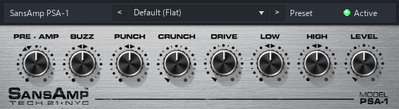

# SansAmp PSA-1 (VST3 & Standalone — 1:1 DSP Clone)



Recreación **1:1** en formato **VST3** y **Standalone** (JUCE 8 / C++20) del clásico **Bomb Factory / Tech 21 SansAmp PSA-1** de Pro Tools (AAX), desarrollada por **[@papielguapo](https://github.com/papielguapo)**.

---

## Características Principales

- **Motor DSP 1:1 Exacto**:
  - Ingeniería inversa completa del binario DSP original (`SansAmp PSA-1.aaxplugin` / `SansAmpAlgMono.dll`).
  - Pipeline de **10 etapas** con **2x Oversampling polifásico FIR** dependiente de la frecuencia de muestreo (`44.1/48 kHz`, `88.2/96 kHz` y `176.4/192 kHz`):
    - **92 taps** de subida (46 taps por rama polifásica).
    - **28 taps** de bajada.
    - Latencia reportada exactamente igual al plugin original (**59 muestras**).
  - Tablas de saturación no lineal de coma flotante extraídas byte a byte del binario original:
    - `g_psa1.bin` (**131,072 floats** / 512 KB) — Etapa principal de distorsión y recorte analógico con interpolación lineal + extrapolación de colas asimétricas.
    - `g_psa2.bin` (**4,097 floats** / 16 KB) — Etapa secundaria de saturación armónica.
  - Curvas de potenciómetro (`Knob Taper` por tramos `[0..5..95..100]`) y fórmulas exactas de filtros biquad / shelving para los 8 controles (**Pre-Amp**, **Buzz**, **Punch**, **Crunch**, **Drive**, **Low**, **High**, **Level**).
- **125 Presets de Fábrica Originales (`.tfx`)**:
  - Incluye todos los presets originales organizados por categorías (*Bass*, *Guitar*, *Drums*, *Electric Piano*, *Horns*, *Misc*, *Royalty*, *Special EFX*) más el preset plano de inicialización.
- **Interfaz Gráfica Original + Barra Superior Estilo FL Studio**:
  - Chasis rack original (`567×120`) y los 101 fotogramas de filmstrip por potenciómetro posicionados en sus coordenadas exactas de `SansAmpGUI.xml`.
  - Barra superior oscura estilo **FL Studio** con selector desplegable de presets, botones `<` / `>`, soporte de rueda del ratón, clic central / `Alt+Clic` para resetear controles al 50%, menú contextual con clic derecho y botón LED verde de **Active / Bypass**.

---

## Los 8 Controles del SansAmp PSA-1

| Control | Función en el circuito analógico / DSP |
| :--- | :--- |
| **Pre-Amp** | Ganancia de entrada y carga del filtro previo antes de la primera etapa de saturación. |
| **Buzz** | Énfasis/corte de graves-medios bajos previo a la distorsión (saturación tipo fuzz/buzz). |
| **Punch** | Énfasis de medios en la entrada que define el ataque de púa y cuerpo del instrumento. |
| **Crunch** | Realce de armónicos medios-altos antes de las etapas no lineales (`g_psa1` / `g_psa2`). |
| **Drive** | Ganancia de etapa de potencia hacia el segundo waveshaper y balance con la señal limpia filtrada. |
| **Low** | Ecualizador post-saturación de bajas frecuencias (gyrator / shelving de graves). |
| **High** | Ecualizador post-saturación de altas frecuencias. |
| **Level** | Nivel de salida maestro con compensación automática de ganancia según Drive y EQ. |

---

## Instalación Rápida (Release)

1. Descarga el archivo `.zip` desde la sección [**Releases**](../../releases).
2. Copia **`SansAmp PSA-1.vst3`** en tu carpeta de plugins VST3 de Windows:
   ```text
   C:\Program Files\Common Files\VST3\SansAmp PSA-1.vst3
   ```
3. *(Opcional)* Ejecuta **`SansAmp PSA-1.exe`** directamente si deseas usarlo en modo **Standalone** sin DAW.

---

## Compilación desde el Código Fuente

### Requisitos
- **Windows 10/11 (x64)**
- **Visual Studio 2022 / 2026** (con carga de trabajo *Desktop development with C++*)
- **CMake 3.22+**

### Comandos
```powershell
cmake -B build -DCMAKE_BUILD_TYPE=Release
cmake --build build --config Release --parallel
```

Los artefactos compilados se generan en:
- `build/SansAmpPSA1_artefacts/Release/VST3/SansAmp PSA-1.vst3`
- `build/SansAmpPSA1_artefacts/Release/Standalone/SansAmp PSA-1.exe`

---

## Créditos

- **Desarrollador del port VST3 / Standalone & UI**: [@papielguapo](https://github.com/papielguapo)
- **Algoritmo original**: Bomb Factory Digital / Tech 21 NYC (SansAmp PSA-1)
